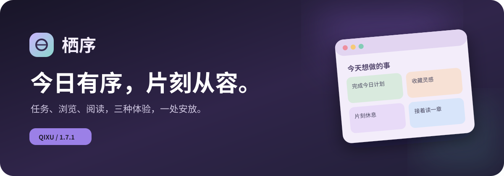

# 栖序 · Qixu

<div align="center">



**给计划一点秩序，给自己一点自由。**

把四象限待办、桌面小组件、轻量网页浏览和沉浸式阅读，装进一款 Windows 桌面应用。

[下载安装](https://github.com/30789126-00/qixu-desktop/releases/latest) · [功能说明](docs/使用说明.md) · [反馈建议](https://github.com/30789126-00/qixu-desktop/issues) · [English](README_EN.md)

   

</div>

## 一张桌面，两种节奏

**认真时，把事情安排好。** 用清晰的四象限管理任务，拖动卡片整理优先级；把小组件留在桌面，随手记下一闪而过的想法，看一眼距离下班还有多久。

**放松时，给自己一个独立空间。** 在同一个窗口里打开视频网站、网页与本地小说，切换标签后接着看。可调透明度、悬浮控制条与窗口内全屏，让内容跟随工作流。

| 整理日常 | 阅读与浏览 |
| :--- | :--- |
| 四象限拖动、任务提醒、撤销 | 哔哩哔哩 / YouTube / 番茄小说 |
| 桌面待办小组件、随手记 | 网页标签、历史记录、书签 |
| 下班倒计时、加班计时 | TXT / EPUB 本地书库与进度续读 |
| 深浅主题、多巴胺配色 | 自动滚动、本地网页翻译、双语字幕 |

<p align="center"></p>

## 为顺手使用打磨的细节

- **老板键，按自己的习惯：** 首次使用可自定义切换快捷键、口令与免验证；以后在「待办侧栏 → 老板键」随时调整。

- **轻巧隐藏与恢复：** 一组快捷键收起影音窗口；支持鼠标移出自动隐藏、停留恢复，隐藏时暂停播放并静音。窗口的位置和尺寸会保留。
- **窗口内全屏：** 视频占满栖序的内容区域，退出后恢复原窗口尺寸；提供悬浮式播放、暂停与退出控制。不同站点的网页播放器行为可能有差异。
- **上次看到哪里，回来接着看：** 记忆视频页面与播放位置、本地小说进度、窗口和设置，并提供意外退出后的会话恢复。
- **属于自己的本地书架：** 导入 TXT、EPUB，支持目录、查找、书签、字号、主题与匀速自动滚动。
- **阅读外文少切换：** 对支持的外文网页进行本地翻译；对可获取的现有视频字幕进行中英双语展示。翻译模型在本机 CPU 上运行，无须单独申请在线翻译 API Key。
- **更适合桌面的设置：** 自定义透明度、置顶、开机自启、网站来源与键盘快捷键。

> 小提示：栖序提供的是便捷的本地界面切换与隐藏体验，**不提供文件加密或真正的访问控制**。网站登录、字幕、视频播放与跳过可跳过广告，取决于网站本身的支持及网络环境。不会绕过原站的会员或付费限制。

## 快速开始

**系统：** Windows 10 / 11 x64。

1. 打开 **[Releases 下载页](https://github.com/30789126-00/qixu-desktop/releases/latest)**，获取最新的 `Qixu-Setup-*-x64.exe`。
2. 运行安装包。首次安装默认使用当前 Windows 用户的应用目录；已安装到 `F:\栖序` 的旧版本继续沿用原位置。
3. 启动「栖序」，进入待办界面；需要影音阅读时，可在待办界面通过快捷键进入访问验证。

桌面版内置本地翻译模型，因此安装包较大；下载后可离线使用已导入的本地小说。在线网站仍需要网络连接。

⚠️ **Windows SmartScreen：** 此个人项目目前没有代码签名证书，Windows 可能显示未识别发布者。仅从本项目 Releases 下载，并根据页面中的 SHA-256 校验文件，不要关闭系统安全保护。

## 从源码构建

依赖：Node.js 22.12+、npm、Windows .NET Framework 4.x 的 C# 编译器。

```powershell
npm ci
node scripts/prepare-models.cjs
npm test
npm run package
```

构建产物输出至 `release/`。模型固定版本并按 SHA-256 校验；源码仓库**不包含约 900 MB 的模型权重**。本地模型权重、用户书籍、任务数据、Cookie 与个人登录会话均不进入 Git 仓库。

核心技术：**Electron · React · TypeScript · Vite · WPF · epub.js · Transformers.js**。

## 版本与反馈

当前公开版：**v1.7.3**。重点是窗口状态、影音隐藏恢复、多标签、播放和阅读位置持久化，以及 Windows 安装位置兼容。完整信息见 [更新记录](CHANGELOG.md) 和 [使用说明](docs/使用说明.md)。

欢迎在 [Issues](https://github.com/30789126-00/qixu-desktop/issues) 提交 Bug、交互建议或站点适配问题。反馈时请勿附上账户 Cookie、书籍原文、个人任务清单或其他隐私文件。

**喜欢栖序？可以点亮右上角的 ⭐ Star，并选择 Watch → Custom → Releases**，以后每次发版都能及时看到。

## 使用范围与第三方许可

这是持续迭代中的 Windows 个人项目，目前**不保证所有视频网站的播放器、登录与字幕功能完全可用**。页面翻译依赖网站结构；现有字幕缺失时不进行语音识别。

翻译模型来自 [Xenova/nllb-200-distilled-600M](https://huggingface.co/Xenova/nllb-200-distilled-600M)，其模型权重单独遵循 **CC BY-NC 4.0（非商业）**；具体版权、依赖与许可见 [第三方声明](THIRD_PARTY_NOTICES.txt) 和 [模型卡](models/MODEL-LICENSE-AND-CARD.md)。其他第三方平台商标与内容归原权利人所有。本仓库公开源码供查看与反馈，**尚未授予额外的源码再分发或商业使用许可**。

---

<div align="center"><sub>QIXU · 今日有序，片刻从容</sub></div>

