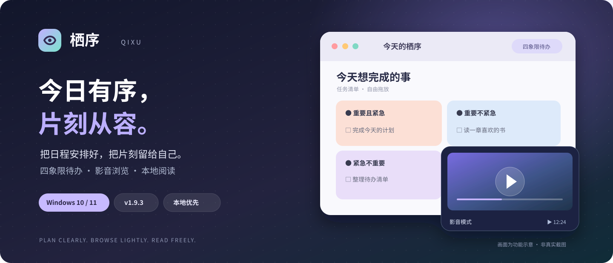

# Qixu · A little order, a little room to breathe.

<div align="center">



**A Windows desktop companion for planning, browsing and reading.**

[**⬇ Download latest**](https://github.com/30789126-00/qixu-desktop/releases/latest) · [Release notes](https://github.com/30789126-00/qixu-desktop/releases) · [Report an issue](https://github.com/30789126-00/qixu-desktop/issues) · [简体中文](README.md)


</div>

## Two modes, one desktop


**Plan with clarity.** Organize tasks in a four-quadrant Eisenhower Matrix and drag them between priorities. Keep a colorful desktop widget with notes, reminders, and a countdown to the end of your workday.

**Unwind with ease.** Use tabs for Bilibili, YouTube, Fanqie Novel and other supported websites. Adjust the window's opacity and always-on-top behavior, and use optional mouse-leave hiding and keyboard shortcuts.

## Your own reading space


Import **TXT and EPUB** books. Navigate chapters, search, bookmark, adjust typography, auto-scroll, or listen using local text-to-speech with a sleep timer. Qixu saves reading progress between sessions.

## Thoughtful details

- **Per-video resume and session recovery:** Preserve supported video positions and reopen previously used tabs after interruptions.
- **Fullscreen within the app window:** Fill the existing content area while keeping the outer window in place.
- **Quiet hiding and restoring:** Optional mouse-leave hide, playback pause and mute; customizable shortcut and password settings.
- **Local translation:** Translate supported foreign-language webpages on the device; bilingual subtitles depend on accessible caption tracks.
- **Tasks and backups:** Recurring to-dos, project labels, save-status feedback, and backup/restore workflows.

<p align="center"><br/><sub>Desktop widget</sub></p>

## Latest release · v1.9.3

The latest release improves recovery from certain YouTube playback errors. Qixu detects some player and media failures, retries refresh at most twice per incident, and attempts to resume from the last valid playback position. Recovery still depends on network and website conditions.

[**Read the v1.9.3 release notes →**](https://github.com/30789126-00/qixu-desktop/releases/tag/v1.9.3)

## Install

For **Windows 10 / 11 x64**, download the `Qixu-Setup-*-x64.exe` installer from [Releases](https://github.com/30789126-00/qixu-desktop/releases/latest). Existing installations retain user data and settings during normal upgrades. The installer is large because it contains an offline translation model.

This is a personal project without a commercial code-signing certificate; Windows SmartScreen may show an unknown-publisher prompt. Use only this repository's release assets and compare the published SHA-256 checksum.

## Build

Requires Node.js 22.12+, npm and the Windows .NET Framework 4.x C# compiler.

```powershell
npm ci
node scripts/prepare-models.cjs
npm test
npm run package
```

The repository excludes model weights, personal books, task data, cookies and login sessions. See the [usage guide](docs/使用说明.md), [third-party notices](THIRD_PARTY_NOTICES.txt), and [model card](models/MODEL-LICENSE-AND-CARD.md).

**Limitations and licenses:** Third-party websites control logins, playback and subtitles; not all features work with every site. Window hiding is not data encryption or robust access control. The bundled translation model's weights are licensed under **CC BY-NC 4.0**. The public repository has not been granted additional unrestricted redistribution or commercial-use rights.

If Qixu is useful, **Star** the project and select **Watch → Custom → Releases** to follow updates.

<sub>Product images above are illustrations, not actual screenshots.</sub>
